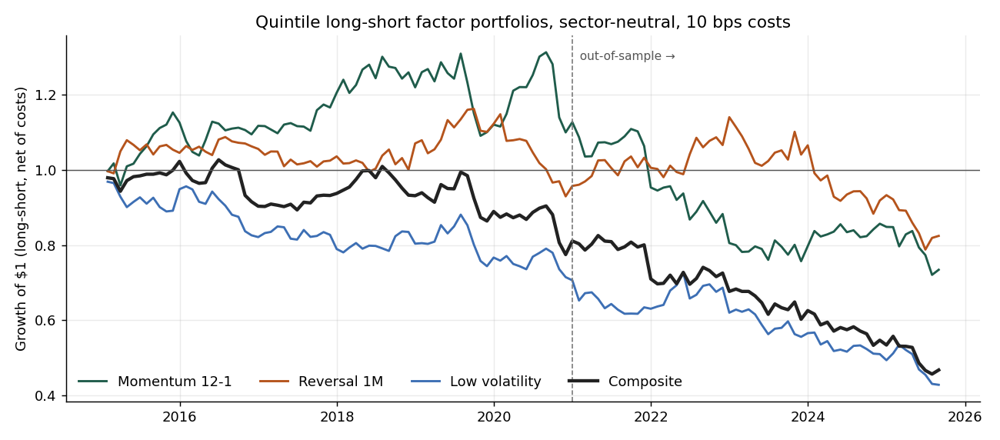
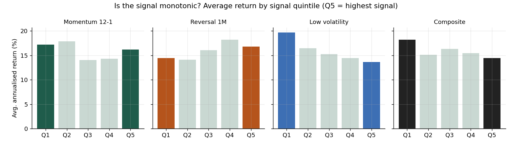
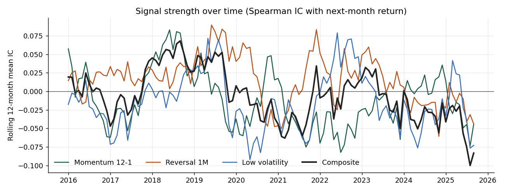

# Equity Factor Research: Do Classic Factors Still Work in US Large Caps?

A backtest of three well-known equity factors (**12-1 momentum**, **one-month reversal** and
**low volatility**) and an equal-weighted composite, on 97 large US stocks from 2015 to 2025.
The setup is the one used in quantitative alpha research: monthly rebalancing, quintile
long-short portfolios, sector-neutral variants, information coefficients, transaction costs
and a strict split between in-sample and out-of-sample periods.

**Short answer: no.** After costs, none of the factors made money in this universe and period,
and the backtest helps explain why. A negative result is still a result. The point of this
project is a pipeline that would have caught an overfit signal before money went into it.

## How to run

```bash
pip install -r requirements.txt
python src/fetch_data.py     # ~12 years of daily adjusted closes -> data/prices.csv
python src/analysis.py       # backtests -> output/ and figures/
python -m pytest -q          # 6 tests, including look-ahead-bias checks
```

## Setup

| Item | Choice |
|---|---|
| Universe | 97 large-cap S&P 500 stocks, fixed list ([`src/fetch_data.py`](src/fetch_data.py)) |
| Data | Daily adjusted closes, Jan 2014 to Sep 2025 (split- and dividend-adjusted) |
| Rebalance | Month-end; signal at *t* is paired with the return from *t* to *t+1* |
| Portfolio | Long the top quintile, short the bottom quintile, equal weights, $1 long / $1 short |
| Neutralisation | Raw cross-sectional z-scores, and **within-sector z-scores** (GICS sectors) |
| Costs | 10 bps per dollar traded (a sensitivity test runs from 0 to 50 bps) |
| Split | In-sample 2015–2020 (72 months), **out-of-sample 2021–2025** (57 months) |

**Signals**
- **Momentum 12-1:** return from 12 months ago to 1 month ago. The latest month is skipped
  because it tends to reverse.
- **Reversal 1M:** minus last month's return.
- **Low volatility:** minus the volatility of daily returns over the past 3 months.
- **Composite:** the average of the three z-scores, re-standardised.

## Results

Sector-neutral, net of 10 bps costs:

| Factor | Period | Ann. return | Sharpe | Gross Sharpe | Max DD | Mean IC | IC t-stat | Turnover |
|---|---|---|---|---|---|---|---|---|
| Momentum 12-1 | In-sample | +2.0% | 0.24 | 0.35 | −17% | 0.004 | 0.16 | 0.49 |
| Momentum 12-1 | **Out-of-sample** | **−8.2%** | **−0.63** | −0.53 | −36% | −0.028 | −1.16 | 0.56 |
| Reversal 1M | In-sample | −0.7% | −0.05 | **0.41** | −20% | 0.018 | 1.01 | **1.57** |
| Reversal 1M | Out-of-sample | −2.5% | −0.18 | 0.17 | −31% | 0.011 | 0.49 | 1.58 |
| Low volatility | In-sample | −5.6% | −0.60 | −0.44 | −27% | −0.019 | −1.00 | 0.59 |
| Low volatility | Out-of-sample | −10.2% | −0.83 | −0.73 | −41% | −0.021 | −0.79 | 0.51 |
| Composite | Full period | −6.9% | −0.66 | −0.38 | −56% | −0.009 | −0.63 | 1.19 |

For comparison, the equal-weighted universe returned **16.1% a year (Sharpe 1.11)** over the
same period. Full results, including the non-neutralised versions, are in
[`output/factor_results.csv`](output/factor_results.csv).



### What the backtest shows

1. **Momentum looked fine in-sample and then failed.** In 2015–2020 it earned a modest
   positive Sharpe (0.24). Out-of-sample it lost 8% a year, with its worst losses in
   2021–2022 (−15% each year), when the market's leaders rotated sharply. This is the
   pattern an in-sample/out-of-sample split exists to catch.
2. **Reversal had a real signal that costs wiped out.** Its information coefficient is the
   only consistently positive one (full-period IC t-stat 1.6 in the raw version), and its
   gross Sharpe was 0.45. However, it trades about 1.6x its gross book every month, which is
   about $3.2 for every $1 long and $1 short. At 10 bps that costs about **3.8% a year**,
   which is enough to turn the result negative.
3. **Low volatility was the wrong way round.** The *most* volatile quintile returned 19.7% a
   year and the least volatile 13.7%. The quintile chart below is close to monotonic in the
   opposite direction to the textbook "low-volatility anomaly".
4. **Combining the signals didn't help.** Momentum and low volatility have a return
   correlation of 0.36, so their losses partly stacked rather than diversifying.




### Why: survivorship bias

The universe is a list of companies that are large *today*. That choice quietly selects
stocks that went up, many of them high-volatility technology names such as NVDA and AVGO,
whose volatility came with large gains. As a result:

- the equal-weight benchmark (16.1% a year) is flattered
- low volatility is penalised, because the high-volatility stocks that *failed* never made the list
- long-short spreads in general are distorted

A proper test needs **point-in-time index membership**, including companies later removed
from the index. Interpret this backtest with that in mind. It is the most important caveat here.

### Cost sensitivity (composite)

| Cost (bps per dollar traded) | 0 | 5 | 10 | 20 | 30 | 50 |
|---|---|---|---|---|---|---|
| Sharpe | −0.38 | −0.52 | −0.66 | −0.95 | −1.23 | −1.80 |

## Checks against common backtest errors

- **Look-ahead bias:** signals at *t* use prices up to *t* only. `tests/test_factors.py`
  shocks the current price and asserts that today's momentum value doesn't change, and it
  checks that forward returns are the *next* month's.
- **Sanity check:** a "perfect" signal (the future return itself) must give strictly
  increasing quintile returns. The test checks this.
- **Dollar neutrality:** long-short weights sum to 0 with a gross exposure of 2, also tested.
- **Turnover and costs** are charged on actual weight changes, not assumed.

## Next steps

1. Point-in-time S&P 500 membership to remove survivorship bias.
2. A broader universe (mid caps) where these anomalies have historically been stronger.
3. Volatility-scaled momentum to reduce the 2021–2022 crash risk.
4. Lower-turnover reversal, for example trading only names whose signal has moved past a threshold.

## Project layout

```
src/fetch_data.py   price download (Yahoo Finance chart endpoint)
src/factors.py      signal construction, z-scoring, sector neutralisation, quintile portfolios
src/metrics.py      Sharpe, drawdown, turnover, information coefficient
src/analysis.py     runs every backtest, writes output/ and figures/
tests/              look-ahead, monotonicity, neutrality and metric tests
```

Sector labels come from the [datasets/s-and-p-500-companies](https://github.com/datasets/s-and-p-500-companies)
list. Price data is for research use only.
